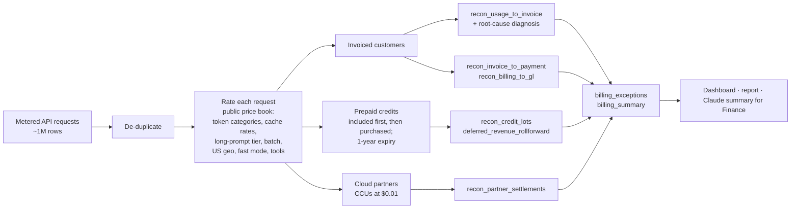

# Token Revenue Integrity Monitor

**A dbt + DuckDB pipeline that rates every API request at Anthropic's public list prices, reconciles every way customers pay (invoices, prepaid credits, cloud partners), and traces each billing error to the specific pricing rule that caused it.**

**[Live dashboard](https://YOUR-APP.streamlit.app)** · [Business case](docs/business_case.md) · [Monthly report](reports/revenue_integrity_report.md) · [Sources & assumptions](docs/sources.md)

> At a $65B+ revenue run rate, every basis point of billing error is about **$6.5M a year**. Token pricing has many rules that stack on one request: five token categories per model, model-specific cache rates, long-prompt tiers, batch discounts, US-only inference, fast mode, and tool fees. Customers pay through prepaid credits, monthly invoices, or cloud marketplaces. This project is the data foundation that keeps all of it accurate.

## What it found

On one synthetic month (**~1M requests, 121B tokens, 150 customers**), the monitor found all **14 planted problems** and named the right cause for each:

| Cause, found automatically | Effect |
|---|---|
| Haiku 5.5 long-prompt rate missed because cache tokens were left out of prompt length | Under-billed |
| US-only inference (`inference_geo: "us"`) billed without the 1.1x multiplier | Under-billed |
| Cache hits on Opus/Sonnet 5.5 billed at the generic 0.1x instead of 0.05x | Over-billed |
| Batch discount applied to input/output but not to cache tokens | Over-billed |
| Failed web searches billed (they're free) | Over-billed |
| 1,550 free code-execution hours not applied | Over-billed |
| Metering retries billed twice | Over-billed |
| Late-arriving usage missed the month-end billing run | Under-billed |
| A cloud partner closes the month in Pacific time, so its CCU settlement misses UTC hours | Under-settled |
| Requests kept being served after prepaid credits ran out | Unpaid usage |
| Credits spent after their one-year expiry | Breakage misstated |
| Past-due and short payments; a GL entry that doesn't match the invoice | Collections / reporting |

Leakage and overcharges are reported separately, in dollars and **basis points of usage**, because under-billing costs revenue and over-billing costs customer trust.

## How it works



**Root-cause diagnosis:** `int_rated_requests` prices every request correctly *and* under each known mistake. When an invoice line is off, `recon_usage_to_invoice` checks which mistake reproduces the invoiced amount to the cent and labels it. Anything no scenario explains is flagged `unexplained`.

## How this maps to the role

| Data Engineer, Billing & Payments | Where it is in this repo |
|---|---|
| Build dbt models that produce canonical billing, usage, and payments datasets | `models/` staging → intermediate → marts; `int_rated_requests` is the canonical rated-usage table (incremental) |
| Own revenue data accuracy and reconciliation across systems | Invoices, partner settlements, credit ledger, payments, and GL, each reconciled to rated usage |
| Define success metrics for billing systems and build monitoring | `billing_summary`: leakage and overcharge in bps; `billing_exceptions` with severity, owner-ready causes; daily runs |
| Set data integrity standards and SLAs | dbt tests: keys, accepted values, referential integrity, one price per model and tier, every request priced, ledger ties to lots, deferred revenue rolls forward |
| Partner with Billing Engineering, Finance, and Accounting on revenue metrics and reconciliation | Deferred revenue roll-forward and breakage; GL reconciliation; [recommendations](docs/business_case.md#4-recommendations) |
| Dashboards and self-serve data products | Streamlit app with tabs per domain; marts ready for Hex or any BI tool |
| Orchestration and on-call data operations | GitHub Actions daily run; Airflow DAG with retries (`dags/`) |
| Billing concepts: invoicing, payments, credits, subscriptions | All four are modeled, plus partner settlements |

## Beyond reconciliation: business insight

- **Pricing levers** (`mart_pricing_levers`): the revenue effect of batch discounts, prompt caching, US-only inference, fast mode, and long-prompt pricing, compared with list price.
- **Subscription economics** (`mart_subscription_economics`, `mart_usage_cap_scenarios`): flat-rate plan price vs. the API-list-price value of each subscriber's usage, how concentrated heavy usage is, and how few subscribers a usage cap would touch. The subscription data is synthetic; the method is the point.
- **Claude summary for Finance** (`scripts/explain_exceptions.py`): Claude turns the exceptions into a short memo with owners and next steps.

## Run it

In your browser with GitHub Codespaces (**Code → Codespaces → Create codespace**), or locally:

```bash
pip install -r requirements.txt
python scripts/generate_data.py            # ~1M synthetic requests (add --requests 60000 for a quick run)
dbt build --profiles-dir .                 # load seeds, build every model, run every test
python scripts/build_report.py             # writes reports/revenue_integrity_report.md
streamlit run app/streamlit_app.py         # dashboard
# optional: export ANTHROPIC_API_KEY=... && python scripts/explain_exceptions.py
```

## Design choices

- **Rate at the request level.** Long-prompt pricing is decided per request, and data-residency and batch multipliers apply per request, so request grain is the only grain where every rule can be applied correctly.
- **Price book as data, not code.** Prices live in a versioned seed with one row per model and pricing tier; a test guarantees exactly one price applies.
- **Compare unrounded sums to rounded invoices with a tolerance** ($0.05), so rounding never shows up as a false alarm.
- **De-duplicate before rating, but keep the evidence.** Metering retries are removed from expected revenue and still reported.
- **Separate deferred revenue from included credits.** Purchased credits are deferred revenue until used or expired; included subscriber credits are a memo line.
- **Incremental by ingestion time.** Each run rates only newly ingested requests; late-arriving usage is caught instead of lost.

## Limitations

All customers, usage, invoices, and subscriptions are synthetic. Prices and billing rules come from public pages ([sources and assumptions](docs/sources.md)). The planted bugs and partner behavior are hypothetical scenarios, not claims about Anthropic's systems. At production scale this would read from the warehouse, add source freshness checks and data contracts with Billing Engineering, and route alerts to owners.

## About

Built by **Harleen Kaur**, Senior Analyst, Business Operations at Comcast, where I run usage-based billing and subscription renewals. I designed the billing scenarios, reconciliation logic, and business analysis, and built the pipeline with Claude as a coding partner. Independent project, not affiliated with Anthropic.

[LinkedIn](https://linkedin.com/in/hkaur626/)
